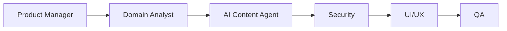

# Workflow: Ai Content Draft

## Routing

Product Manager → Domain Analyst → AI Content Agent → Security → UI/UX → QA.

## Steps

1. collect structured facts.
2. generate bounded draft.
3. flag missing/uncertain facts.
4. human edit/approve.
5. store provenance and usage.

## Gates

Domain owner validates rules; risky steps require human approval; security and QA are independent; provider work uses sandbox; completion includes audit, observability, tests, documentation, deployment and rollback evidence.
