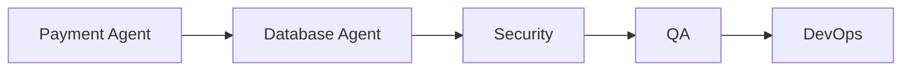

# Workflow: Payment Processing

## Routing

Payment Agent → Database Agent → Security → QA → DevOps.

## Steps

1. verify signature/event.
2. lock order/payment.
3. idempotent state transition.
4. entitlement/outbox transaction.
5. reconcile delayed/duplicate/out-of-order.

## Gates

Domain owner validates rules; risky steps require human approval; security and QA are independent; provider work uses sandbox; completion includes audit, observability, tests, documentation, deployment and rollback evidence.
