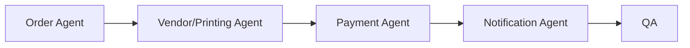

# Workflow: Printing Vendor Order

## Routing

Order Agent → Vendor/Printing Agent → Payment Agent → Notification Agent → QA.

## Steps

1. capture specification/quantity.
2. quote and payment.
3. proof approval.
4. vendor production updates.
5. shipping and customer notifications.

## Gates

Domain owner validates rules; risky steps require human approval; security and QA are independent; provider work uses sandbox; completion includes audit, observability, tests, documentation, deployment and rollback evidence.
