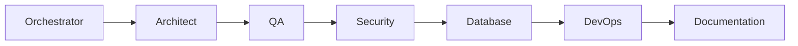

# Workflow: Release

## Routing

Orchestrator → Architect → QA → Security → Database → DevOps → Documentation.

## Steps

1. collect task evidence.
2. run full gates.
3. approve migrations.
4. deploy progressively.
5. smoke/observe/rollback if needed.

## Gates

Domain owner validates rules; risky steps require human approval; security and QA are independent; provider work uses sandbox; completion includes audit, observability, tests, documentation, deployment and rollback evidence.
