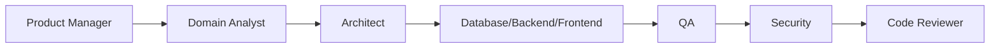

# Workflow: Rsvp Feature

## Routing

Product Manager → Domain Analyst → Architect → Database/Backend/Frontend → QA → Security → Code Reviewer.

## Steps

1. clarify household/event/pax/deadline.
2. plan schema/API/idempotency.
3. implement token-scoped use case.
4. test duplicate/concurrent/expired/cross-tenant.
5. review and release.

## Gates

Domain owner validates rules; risky steps require human approval; security and QA are independent; provider work uses sandbox; completion includes audit, observability, tests, documentation, deployment and rollback evidence.
