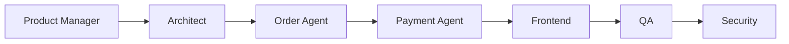

# Workflow: Template Purchase

## Routing

Product Manager → Architect → Order Agent → Payment Agent → Frontend → QA → Security.

## Steps

1. select active template/price.
2. create immutable order item.
3. start payment.
4. verified webhook grants entitlement.
5. provision workspace and notify.

## Gates

Domain owner validates rules; risky steps require human approval; security and QA are independent; provider work uses sandbox; completion includes audit, observability, tests, documentation, deployment and rollback evidence.
