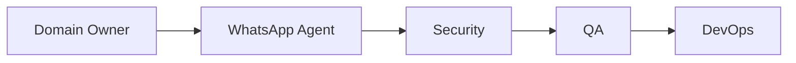

# Workflow: Whatsapp Notification

## Routing

Domain Owner → WhatsApp Agent → Security → QA → DevOps.

## Steps

1. check consent/category/template.
2. enqueue idempotently.
3. send through adapter.
4. process delivery callback/retry/suppression.
5. measure cost without PII.

## Gates

Domain owner validates rules; risky steps require human approval; security and QA are independent; provider work uses sandbox; completion includes audit, observability, tests, documentation, deployment and rollback evidence.
